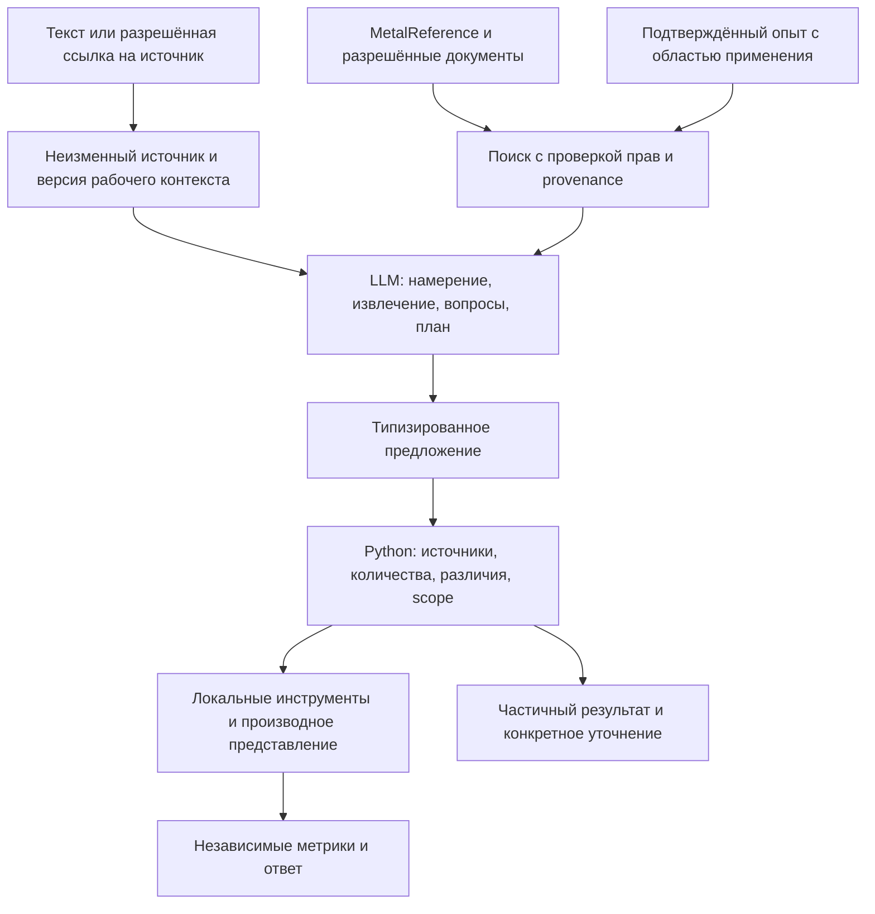

# Steel Agent v2 — архитектура для согласования

Дата: 2026-10-17. Статус: проект, реализации и запуска нет.
Экспериментальная ветка `feature/steel-agent-v2` создана строго от
`19c9657fdc0ef9005e7478ea8a886c6763a9a006`. Production не изменяется.
B1–B10 не перенесены; их ветки, тесты и отчёты сохраняются как сравнительные материалы.
Ни новый справочник, ни база памяти, ни агентный фреймворк сейчас не создаются.

## 1. Цель и границы

Предметно-ориентированный LLM-агент по металлопрокату должен понимать свободные
заявки и рабочий диалог, объяснять различия и готовить закупочное представление.
Его задача — совместить контекстное понимание с проверяемыми исходными данными,
а не наращивать цепочку частных регулярных исключений под очередной expected.
ИИ предлагает интерпретации и действия; Python проверяет их и выполняет разрешённые
операции. Короткий закупочный текст не становится источником технической истины.

Первый эксперимент: текстовые заявки, уточнения, нормализованное представление,
сравнение с legacy. Рассылки, закупки, изменения Bitrix и автономные технические
замены не входят в него. Telegram — будущий адаптер, а не ядро агента.

## 2. Что установлено read-only аудитом основы

Изучены `ARCHITECTURE.md`, `docs/METAL_REFERENCE.md`,
`docs/TECHNICAL_MATCHING.md`, `docs/NORMALIZATION_STAGE_ONE.md` и Python-контракты.
Ни пользовательские БД, ни секреты для аудита не нужны и не читались.

| Компонент | Фактическая возможность и ограничение | Решение для v2 |
|---|---|---|
| `nomenclature.py` | NomenclatureSpec, состояния Attribute, Decimal, provenance; количество отдельно от идентичности | Основной технический контракт, без второго каталога моделей |
| `normalization_context.py` | CorrectionRecord, ConfirmedExperience, scope, подтверждение и версии; это контракты, не готовая память | Основа проверенного опыта |
| `recognition.py` | Локальное пакетное распознавание, уникальные record_id; ограниченные категории/грамматики | Необязательный инструмент извлечения/проверки, не универсальный gate |
| `reference_lookup.py`, `metal_reference/reader.py`, `reference_matching.py` | Чтение имеющегося MetalReference и кандидаты с provenance | Первый структурированный канал RAG |
| `technical_matching.py` | Пять исходов, различия и недостаточность; без утверждённой политики не обещает exact | Инструмент оценки технических гипотез |
| `quantity.py` | Точный перевод единиц и суммирование, ограниченные расчётные методы | Единственный арифметический исполнитель |
| `commercial.py`, `consolidation.py`, `normalization_policy.py` | Производные группы, scoped decisions и защитные проверки | Повторно использовать инварианты/проверку решений; не наследовать все эвристики как политику v2 |
| `ai.py` | Извлечение и интерпретация правок через Chat Completions, проверки фрагментов | Транспорт и типизированный ответ — кандидаты на адаптер; старый pipeline не запускать внутри агента |
| `work_assistant.py` | Отдельный Responses-помощник, поиск и ограничения в памяти процесса | Переиспользовать безопасную работу с источниками; не считать готовым общим контроллером затрат |
| `repositories/telegram_repository.py` | Снимки active/history, диалог, расчёт, routing; конструктор создаёт таблицы | Репозиторный шаблон и совместимость; не открывать production из эксперимента |
| `database.py`, `repositories/*`, `metal_reference/schema.py` | SQLite и репозитории, существующий справочник | Сохранить; новые схемы только отдельным решением позже |
| `diagnostics.py` | Этапы, задержки, число вызовов/попыток без текста заявки | Сохранить и расширять отдельно по согласованному плану |
| `telegram_access.py`, `telegram_bot.py`, Windows-скрипты и supervisor | Доставка, права, штатное управление процессами | Сохранить вне экспериментального ядра; не запускать второй polling |

В основе нет готовой долговременной памяти подтверждённых исправлений и полного
универсального RAG. Наличие контрактов не означает наличие работающего обучения.
Документация будущих Bitrix-адаптеров также не доказывает реализованную интеграцию.
Модель, reasoning, endpoint и настройки действующего бота на этом этапе не меняются.

## 3. Поток LLM + RAG + опыт + инструменты

Один небольшой application coordinator, а не группа автономных агентов.
Он ограничивает шаги и предоставляет LLM только разрешённые инструменты.
Поиск сначала структурированный: категория, размер, полное обозначение, документ,
источник. Семантический поиск добавляется только при измеренном дефиците поиска;
отдельная векторная БД не является обязательным первым шагом.

RAG возвращает evidence с ID источника/версией, фрагментом, областью применимости,
типом знания и причиной выбора. Факт MetalReference, цена поставщика и опыт
снабженца имеют разный статус. Кандидат не дополняет пропущенную марку в заявке.
При противоречии источников сохраняются обе версии и вопрос; выбор первого
результата запрещён. Найденный документ не заменяет пользовательский ГОСТ.
Проверка текущего статуса документа нужна по запросу, а не для каждой нормализации.

## 4. Ответственность ИИ и Python

| ИИ | Python |
|---|---|
| Понимает естественное намерение и предлагает связанные исходные фрагменты | Назначает ID, хранит оригинал/версию, проверяет ссылки и покрытие |
| Извлекает технические гипотезы и явно отмечает неизвестное | Проверяет схему, подтверждение полей, конфликт и неполноту |
| Предлагает закупочные группы с причинами | Проверяет состав, разрешения, суммы Decimal и однократное включение |
| Формирует понятное уточнение и объяснение различий | Выполняет атомарную правку по expected_revision и точным ID |
| Выбирает подходящий разрешённый поисковый инструмент | Проверяет права, scope, лимиты, тайм-аут и доступные источники |

ИИ не вычисляет контрольные суммы, не назначает сам себе разрешение на замену,
не исполняет SQL/произвольный код и не получает секреты. Текст заявки, прайс и
извлечённый документ считаются данными, включая содержащиеся в них инструкции.
Неполный разбор не запрещает вернуть оригинал и подтверждённую часть. Ошибка
одной строки не отменяет доказуемые соседние строки; неизвестная часть видима.

## 5. Минимальные структурированные результаты

Это проект композиции имеющихся контрактов, а не новые реализованные модели.
Версионировать envelope; не менять Product v1 и RequestItem автоматически.

| Сущность | Минимальные поля | Инвариант |
|---|---|---|
| SourceEnvelope | source_id, source_type, external_ref?, revision/hash, original_text, записи/фрагменты с диапазонами | Оригинал неизменен; одинаковые вхождения имеют разные record_id |
| SourceRecord | record_id, SourceRef, literal_fragment, locator, kind: product/header/note/unresolved | Неизвестная строка не выбрасывается; общая шапка не применяется без scope |
| TechnicalResult | record_id, NomenclatureSpec, status, issues, evidence, extraction/model/prompt/rule versions | Исходная характеристика, распознанное значение и normalized_text разделены |
| NormalizationResult | request_id, revision, context_id, records, unresolved_record_ids, questions, differences | Не выдавать partial за полную обработку |
| CommercialGroup | group_id, source_record_ids, display_label, quantity: Measurement, representative/evidence, decision_ref?, differences | Количество вычисляет Python; факты исходных позиций не меняются |
| Difference | path, before, proposed, layer, reason, evidence, risk, scope, confirmation_ref?, validation_status | Коммерческая подпись и техническая замена — разные слои |
| OperationProposal | operation_id, request_id, expected_revision/fingerprint, target_ids, patch, scope, evidence | Проверка всего набора и атомарное применение либо отказ |

Использовать имеющиеся Attribute states: missing, present, unknown, ambiguous,
conflict. Отсутствие покрытия не равно «без покрытия»; одинаковые unknown не
доказывают совпадение. Значения количества и геометрии — Decimal, JSON — строки.
Единица не выводится из порядка числа без проверяемого основания. В новых
envelope хранить уверенность/основание отдельно от факта: self-confidence LLM
не подтверждает характеристику. Разрешённые extension-поля ограничены категорией.

CommercialDecision/GradeRule дают полезные существующие формы scope и версии.
Их runtime-предикаты проверяются отдельно до повторного использования. Например,
краткое желаемое название не разрешает стереть form или поменять редакцию ГОСТ.
Нет общего требования ужать любую заявку до заданного числа групп.

## 6. Память проверенных исправлений снабженца

Поток: предложение → исходная ошибка и before/after → причина → область →
подтверждение уполномоченным человеком → регрессия → доступный проверенный опыт.
Основа: CorrectionRecord, KnowledgeScope, UserConfirmation, RuleVersion,
ConfirmedExperience. Дополнительно проектируются статус отзыва, срок действия,
владелец доступа, ссылки на регрессии и заменённую версию; сейчас они не хранятся.

Разовое исправление по умолчанию относится к request_id и его контексту.
Повторное применение к категории или всем заявкам требует отдельного явного
расширения scope; частота похожих исправлений сама по себе его не даёт.
Память хранит слой: техническое требование, распознанный атрибут, написание,
коммерческая группа либо возможный аналог. Коммерческий опыт не становится
нормативным свойством MetalReference и не меняет веса модели.

Извлечение опыта: сначала права и confirmation/revocation/version, затем точные
условия категории, марки, документа, поставщика и запроса, затем ранжирование.
Семантическое сходство только ищет кандидатов; Python проверяет применимость.
При конкурирующих подтверждённых версиях — различия и уточнение, не скрытая
перезапись. Новая заявка получает новый рабочий контекст, не прежние pending-вопросы.
Журнал исправлений и retrieval traces позволяют понять, какой опыт повлиял на ответ.
До сбора реальных примеров согласовать доступ, обезличивание, хранение и удаление;
коммерческие тексты и персональные данные не попадают в Git и обычные логи.

## 7. Bitrix24 без копирования всех заявок

Следовать существующему проекту `docs/NORMALIZATION_STAGE_ONE.md`:
Bitrix остаётся источником заявок, комментариев, статусов и прав. Локально —
external_ref, revision/hash, минимальные поисковые признаки, подтверждённые
обезличенные примеры и ссылки на их происхождение. Массовой выгрузки истории нет.

Будущий адаптер: search/get_request/get_comments с actor и cursor; текст
загружается по необходимости после проверки прав. Кэш ограничен временем и
версией, не является вторым архивом. Право на retrieval проверяется повторно
при чтении документа, включая ссылки из памяти и смену прав после индексации.
Готовый контекст не отправляет LLM лишние поля Bitrix.

Запись — отдельное будущее разрешение: apply_patch(expected_revision, patch,
actor, idempotency_key), журнал операции и сверка результата после тайм-аута.
Нет автоматической смены статуса, заказа или отправки письма. Уведомление об
изменении помечает кэш устаревшим, а не дублирует всю заявку. Параметры установки
и фактическая схема модуля пока не проверены; адаптер не реализуется здесь.

## 8. Независимая оценка качества

Проверяющий контур не принимает уверенность извлекающей LLM за метрику.
Контролируемый транспорт измеряет Python; живое извлечение измеряется отдельно.
Эталон коммерческого текста не заменяет эталон технических полей.

| Измерение | Проверка |
|---|---|
| Полнота | Все исходные вхождения учтены как product/header/note/unresolved; нет вымышленных или двойных позиций |
| Характеристики | Полные марки, размеры, документы и редакции, исполнение, ссылки на доказательства; неопределённость сохранена |
| Количества | Точность Decimal на каждом источнике и в группах; суммы отдельно по совместимым единицам; масса неизвестной части не выдаётся за ноль |
| Группировка | Partition источников, false merge/false split, scope решений, признаки скрытого различия; компактность оценивается после безопасности |
| Диалог | Версии/атомарные правки, восстановление после перезапуска, изоляция пользователей, отсутствие лишнего извлечения при просмотре |
| Эксплуатация | Реальные попытки, токены/стоимость, latency p50/p95, timeout/partial; отдельный факт доставки Telegram |

Синтетические и обезличенные кейсы делятся на разработку и закрытую проверку;
проверяются перестановки, дубли, экспортные шапки и неизвестные категории.
Четыре корпуса legacy: 38/205.355 т, 22/121.900 т, 27/442.296 т, 10/476.313 т.
Последний известный B6 ветки B10: 18 passed, 4 failed — не результат основы v2.
Код/fixtures B1–B10 не импортируются автоматически: позднее отдельное согласование
переноса буквальных данных, прав на них и независимой оценки. Итоги B10 — сведения
о legacy, не утверждённые правила v2. Для 100 строк отдельно измерять живую
AI-приёмку; сохранный fallback не равен успешному извлечению.

## 9. Технические риски и инструменты

Пять уровней разделены: исходное требование → распознанный факт → написание →
закупочная группа → кандидат аналога. С245/С255/С345/С355/09Г2С не объявляются
взаимозаменяемыми из-за общей подписи, alias или примера снабженца.
Техническое сопоставление не выдаёт разрешение на автоматическую замену.
Нормативные и фактические массы отделены от теоретической оценки и количества.

Инструменты первой реализации: локальное распознавание, reference lookup,
technical compare, quantity sum/convert, просмотр заявки, проверка и применение
typed patch, построение проверенного коммерческого представления. Вызов содержит
request_id/revision/target_ids, ответ — evidence/status/errors. Подмена инструмента
LLM-текстом запрещена. Сетевые/изменяющие внешние системы инструменты выключены
до отдельного этапа; произвольного SQL/shell-инструмента нет.

Главные риски: галлюцинация группировки, ошибочный scope памяти, утечка через RAG,
prompt injection в документах, размножение сумм при chunking, неполная грамматика
источника, различие старых JSON и новых контрактов, скрытые повторы SDK.
Меры: доказательства, права до retrieval, версии, контролируемый исполнитель,
однократное покрытие ID, транзакции и независимая оценка. Блокируется опасное
действие, а не возврат подтверждённой части заявки.

## 10. Стоимость, число вызовов и время

Это проект политики эксперимента, не возвращение снятых квот PR №9 в production.
Числовые денежные лимиты и модель согласуются до любых живых испытаний; на текущем
этапе допустимый расход равен нулю. Старые $3/$1, ограничения по пользователям
и времени автоматически не восстанавливаются.

Будущий контроллер резервирует согласованный предел до вызова и учитывает
input/output/reasoning tokens по доступному usage, реальные HTTP-попытки и
платные поисковые обращения. Если актуальная цена/верхняя граница не установлены,
платный эксперимент не стартует. Тайм-аут может означать неизвестную стоимость:
резерв не снимается как будто запрос не выполнялся. Автоповторы SDK должны
учитываться и не обходить общий предел.

Для первого эксперимента предлагается, не утверждается: один пакетный вызов
извлечения и не более одного адресного ремонта; общий deadline 120 секунд,
резервный deadline 30 секунд в его пределах; поиск выключен по умолчанию.
Большие документы разбиваются по доказуемым границам с ID, явным количеством
частей и лимитом всего задания; нельзя получить вызов на каждую строку по умолчанию.
Допустимый размер пакета и deadline проверяются измерением, а не обещанием скорости.
До реализации этой политики требуется согласование чисел и покрытия больших заявок.

Локальная арифметика, поиск в справочнике, просмотр и точные правки обходятся
без LLM. Кэш по hash источника, версии контракта/промпта/правил/знаний и scope
сохраняет доказательства и права; кэш другой заявки не переносит её решения.
При исчерпании согласованного ресурса возвращаются сохранённый оригинал,
проверенная часть и причина незавершённости; активная заявка не уничтожается.
Постоянный учёт живого эксперимента проектируется отдельно; сейчас хранилище
не создаётся и существующий ai-budget.sqlite3 не читается/не меняется.

## 11. Экспериментальное внедрение и согласование

1. Согласовать этот документ, минимальные envelopes, риск-модель и полномочия.
   Критерий: роли источников/опыта и границы технической замены однозначны.
2. Сделать один offline vertical slice с заглушкой транспорта, временным
   хранилищем и существующими контрактами/инструментами. Критерий: покрытие,
   Decimal, partial, scope и атомарность подтверждены независимо от LLM.
3. Подключить read-only MetalReference и выборочные подтверждённые примеры.
   Критерий: права, отзыв, конфликт и provenance; нет глобализации разовой правки.
4. После отдельного разрешения — ограниченная живая приёмка на синтетике,
   с согласованными ценой/моделью/deadline. Критерий: качество извлечения и
   группировки плюс фактический расход; fallback оценивается отдельно.
5. Только после оценки — пилот через существующий Telegram-adapter, без второго
   polling. Переключение/остановка и откат — отдельный согласованный deployment.
   До него эксперимент не имеет доступа к токену и рабочей SQLite.
6. Bitrix сначала read-only, затем отдельно согласованный typed patch с
   concurrency/idempotency. Массовая миграция истории не требуется.

На каждом шаге отдельная ветка, проверяемый результат и остановка на согласование.
Сложность: контракты/vertical slice — средняя; качественная память и оценка
группировки — высокая; Bitrix зависит от прав/схемы. Календарные сроки без
выборки и измерений не обещаются. Откат пилота — выбор сохранённой версии кода
и адаптера, а не автоматическое восстановление старой БД поверх новых данных.

## 12. Что оставить за пределами нового конвейера

Сохранить legacy физически, но не включать по умолчанию связку
`TelegramService._build_active → normalize_request → validate_request → _recover`
как агентный движок; старые строковые маршруты `dialog_context.py`/`work_intent.py`
не должны незаметно принимать решения за новый coordinator. Их тесты полезны
как регрессионные сценарии. Частные правила commercial_family/required_fields,
перезапись атрибутов exact_source_attributes и жёсткое совпадение фрагментов
не становятся универсальным определением истины. Из них сохраняются проверяемые
локальные доказательства и инварианты, а не обязательное тотальное принятие/отказ.
Существующий formatter можно использовать через адаптер, но он не должен
определять технические факты или коммерческие разрешения.

Не нужно заново писать Decimal-арифметику, справочник, репозитории, права,
транспорт секретов, диагностику или Windows-supervisor. Совместимость каждого
переиспользуемого компонента проверяется отдельно; импорт runtime-репозитория
не считается read-only, если его конструктор создаёт таблицы.

Решения перед реализацией: политика коммерческих полномочий агента; кто и в
каком scope подтверждает опыт; доступ/обезличивание и срок хранения примеров;
модель и лимиты живого эксперимента; разрешённые источники RAG; критерии
приёмки для unknown/partial и ложного объединения. Новых правил сталей этот
документ не утверждает. После подготовки документа реализация не начинается.
